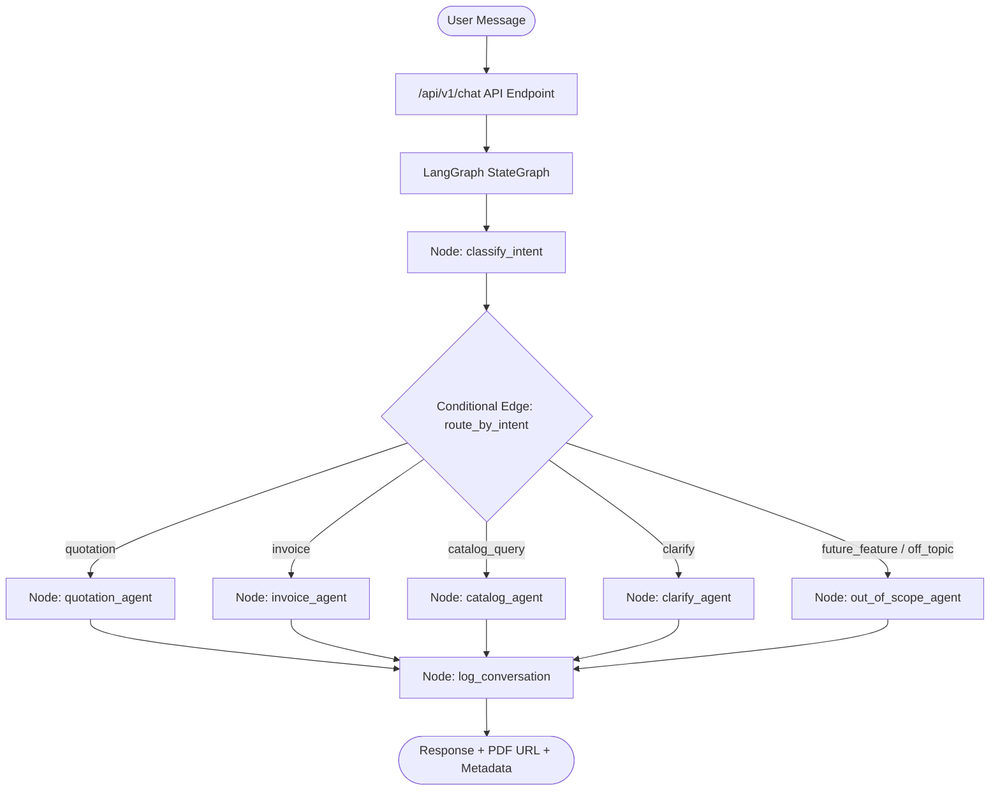
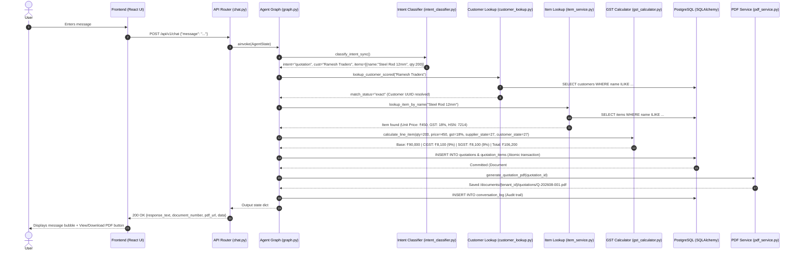
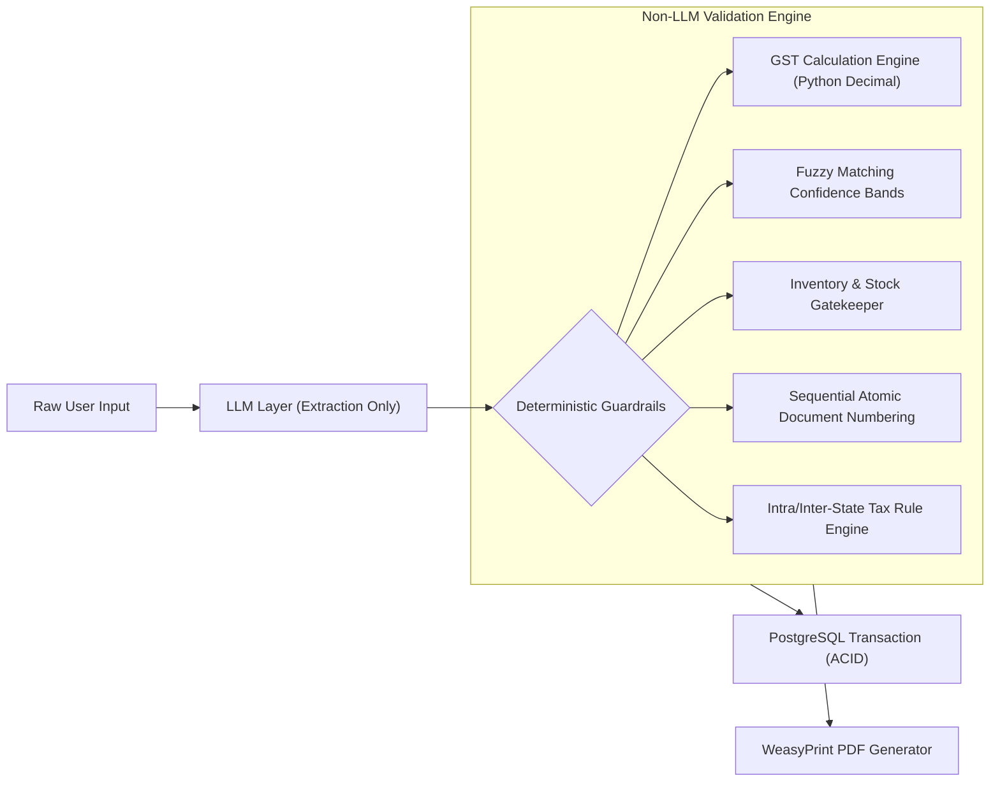

# M1M (Munim.ai) — MVP Technical Architecture & Working Guide

> **Document Type:** Technical Presentation & Slide Source Deck  
> **Date:** August 21, 2026  
> **Scope:** Sprint 1 MVP Implementation (including Pre-Demo Hardening Pass)

---

## 1. Project Summary

**M1M (Munim.ai)** is an AI-native business workflow agent built specifically for Indian Small and Medium Enterprises (SMEs). It allows business owners and sales reps to manage core commerce workflows via natural language chat—converting messy user inputs into structured, audit-compliant GST quotations and tax invoices, generating branded PDFs, and querying live catalog inventory. The system replaces complex ERP UIs with a hybrid architecture: fast LLM-based entity extraction coupled with 100% deterministic, audit-grade business logic and mathematical verification.

---

## 2. Agent Architecture (LangGraph Workflow)



### 2.1 Graph Nodes & Routing Logic

| Node Name | Implementation Function | Actual Responsibility |
| :--- | :--- | :--- |
| **`classify_intent`** | `classify_intent_node` | Runs hybrid classification (Gemini 2.5 Flash with fallback to regex). Populates `detected_intent`, `customer_name`, and `line_items`. |
| **`route_by_intent`** | `route_by_intent` | Conditional routing router. If confidence < 0.60, routes to `clarify_agent`. Otherwise dispatches to intent-specific agent nodes. |
| **`quotation_agent`** | `quotation_agent_node` | Resolves customer and item entities, computes GST, persists `Quotation` and `QuotationItem` records, renders HTML/PDF, and returns download link. |
| **`invoice_agent`** | `invoice_agent_node` | Handles both direct invoice generation and quotation conversions (`Q-YYYYMM-XXX` $\rightarrow$ `INV-YYYYMM-XXX`), locks stock, decrements inventory, and produces signed PDF. |
| **`catalog_agent`** | `catalog_agent_node` | Handles read-only pricing, HSN lookup, stock queries, and catalog listings without creating drafts or modifying state. |
| **`clarify_agent`** | `clarify_agent_node` | Prompts user when required fields (customer name or line items) are missing or ambiguous. |
| **`out_of_scope_agent`**| `out_of_scope_agent_node`| Delivers polite, firm refusals distinguishing future roadmap features (dues reminders, accounting sync) from unrelated off-topic requests. |
| **`log_conversation`** | `log_conversation_node` | Audit sink: writes both inbound and outbound messages into `conversation_log` with detected intent and agent invocation tag. |

### 2.2 Agent Node Data & I/O Breakdown

* **`quotation_agent_node`**:
  * **Reads:** `tenants`, `customers` (fuzzy match), `items` (catalog lookup).
  * **Writes:** `quotations`, `quotation_items`, `customers` (auto-creates if match confidence < 0.4).
  * **External Services:** WeasyPrint / Minimal HTML PDF generator (local filesystem storage under `/documents/{tenant_id}/quotations/`).
  * **Output:** User summary string + `document_id` + `document_number` (`Q-202608-XXX`) + `pdf_url`.
* **`invoice_agent_node`**:
  * **Reads:** `tenants`, `customers`, `items`, `stock_ledger` / `items.current_stock`, `quotations` (for conversion).
  * **Writes:** `invoices`, `invoice_items`, `stock_ledger` (decrement transaction), updates `quotations.status` (`converted`).
  * **External Services:** WeasyPrint / Minimal PDF renderer (local filesystem under `/documents/{tenant_id}/invoices/`).
  * **Output:** Invoice confirmation message + state fallback notes + `pdf_url`.
* **`catalog_agent_node`**:
  * **Reads:** `items` (active SKU prices, HSN, GST rate, unit, stock).
  * **Writes:** None (strictly read-only).
  * **Output:** Product price, tax rates, and live warehouse quantity.

### 2.3 `AgentState` Schema

```python
# Defined in backend/app/agent/state.py
class AgentState(TypedDict):
    tenant_id: str                              # UUID string scoping tenant data
    channel: str                                # "web" | "whatsapp"
    raw_message: str                            # Raw user string
    conversation_history: List[Dict[str, str]]  # Past turn messages for context
    full_conversation_text: str                 # Serialized history for intent classifier
    detected_intent: Optional[str]              # "quotation" | "invoice" | "catalog_query" | etc.
    extracted_entities: Dict[str, Any]          # customer_name, line_items, quotation_number
    missing_fields: List[str]                   # Unresolved parameters needing follow-up
    confidence: float                           # Intent classifier score (0.0 - 1.0)
    draft_document_id: Optional[str]            # Primary key of created document
    draft_document_number: Optional[str]        # Q-202608-001 or INV-202608-001
    pdf_url: Optional[str]                      # Relative URL to download PDF
    response_text: str                          # Output message returned to frontend
    data: Optional[Dict[str, Any]]              # Structured payload (totals, line items, flags)
    customer_match_status: Optional[str]        # "exact" | "fuzzy_high" | "fuzzy_medium" | "none"
    customer_candidate_name: Optional[str]      # Best candidate when confirmation needed
```

---

## 3. End-to-End Execution Flow

**Example Prompt:** `"Quotation for Ramesh Traders, 200 units Steel Rod 12mm"`



---

## 4. Database Schema & Models

Implemented in PostgreSQL using SQLAlchemy 2.0 async ORM and Alembic migrations.

| Table Name | Model File | Purpose | Production Status |
| :--- | :--- | :--- | :--- |
| **`tenants`** | `models/tenant.py` | SME business profile, legal name, GSTIN, PAN, state code, invoice prefix, address. | **Active** (Multi-tenant partition key) |
| **`customers`** | `models/customer.py` | Customer registry, business name, GSTIN, billing/shipping state, contact info. | **Active** (Fuzzy lookup & auto-creation) |
| **`items`** | `models/item.py` | Product catalog, SKU, HSN/SAC code, unit price, GST rate (0/5/12/18/28%), current stock. | **Active** (Catalog search & pricing) |
| **`quotations`** | `models/quotation.py` | Quotation header, quotation number (`Q-YYYYMM-XXX`), status (`draft`/`sent`/`converted`). | **Active** (Document persistence) |
| **`quotation_items`** | `models/quotation.py` | Line items with frozen unit price, taxable base, CGST, SGST, IGST, total. | **Active** (Document persistence) |
| **`invoices`** | `models/invoice.py` | Tax invoice header, invoice number (`INV-YYYYMM-XXX`), payment status, source quotation link. | **Active** (Document persistence) |
| **`invoice_items`** | `models/invoice.py` | Line items with snapshot of HSN, tax split, and final billing totals. | **Active** (Document persistence) |
| **`stock_ledger`** | `models/stock.py` | Audit log for inventory movements (`sale_invoice`, `restock`, `adjustment`). | **Active** (Atomic stock tracking) |
| **`conversation_log`** | `models/conversation_log.py`| Interaction log for all incoming user requests and outgoing responses. | **Active** (Audit logging) |
| **`tally_connections`**| `models/tenant.py` | Stores Tally ERP connection URLs, sync tokens, and last sync timestamp. | *Placeholder* (Future ERP Sync) |
| **`external_id_maps`** | `models/tenant.py` | Mapping between local UUIDs and remote ERP IDs (Tally, Zoho). | *Placeholder* (Future ERP Sync) |

---

## 5. Deterministic Reliability & Safety Mechanisms

M1M prevents LLM hallucinations in mission-critical business transactions using deterministic Python safeguards:



### 5.1 Hardened Reliability Features

1. **Deterministic GST Engine (`gst_calculator.py`)**:
   - **Zero LLM Math:** All tax rates, taxable values, CGST, SGST, and IGST breakdowns are computed in standard Python `Decimal` arithmetic.
   - **Place of Supply Logic:** Automatically compares `supplier_state_code` and `recipient_state_code`.
     - *Intra-state (same state code):* Splits tax evenly into `CGST = GST / 2` and `SGST = GST / 2`.
     - *Inter-state (different state code):* Assigns entire tax to `IGST = GST`.
2. **Three-Tier Fuzzy Matching Bands (`customer_lookup.py`)**:
   - $\ge 0.80$ (`exact` / `fuzzy_high`): Automatic match.
   - $0.40 - 0.80$ (`fuzzy_medium`): Blocks execution and asks user confirmation (*"Did you mean Ramesh Enterprises? Or is this a new customer?"*) without creating unwanted database records.
   - $< 0.40$ (`none`): Auto-creates new customer record, but appends an explicit warning note to the user.
   - **Token Overlap Penalty:** Strips false positives where unrelated companies share generic legal suffixes (e.g. "Systems", "Enterprises").
3. **Fail-Safe Stock & Inventory Gatekeeper (`stock_service.py`)**:
   - Pre-validates inventory before generating invoices.
   - Rejects invoice creation with a clear error if requested quantity exceeds warehouse stock.
   - Updates `stock_ledger` and `items.current_stock` atomically inside the same database transaction.
4. **State-Assumed Fallback Visibility (`invoice_service.py`)**:
   - If customer record has no state code on file, defaults to supplier state for intra-state billing.
   - Sets `state_assumed: True` in the API payload and automatically appends a visible notice:  
     `_Note: I don't have [Customer]'s state on file, so I've calculated this as an intra-state invoice — let me know their state if that's not right._`
5. **Fallback Chains**:
   - **Intent Classification:** Gemini 2.5 Flash $\rightarrow$ Local Regex Parser $\rightarrow$ Clarify Node.
   - **Document Rendering:** WeasyPrint (Cairo/Pango engine) $\rightarrow$ Clean HTML-to-PDF Fallback.

---

## 6. Pre-Demo Hardening Pass Summary

The following engineering improvements were implemented and verified during the pre-demo hardening pass:

* **Tenant Fallback Isolation (`config.py`):** Development-only gating on default UUID fallback. Production mode strictly enforces `SPRINT_TENANT_ID`.
* **Fuzzy Customer Match Confirmation Bands (`customer_lookup.py`):** Added 0.40–0.80 confirmation pause, eliminating accidental customer duplicate creation.
* **Missing Field Prompt Routing (`graph.py`):** Resolved swapped routing logic so missing customer names directly ask for the customer, and missing items directly ask for items.
* **State Assumption Disclosures (`invoice_service.py`):** Added `state_assumed` flag and user-facing notifications for tax rate transparency.
* **Live Catalog & Inventory Querying (`catalog_service.py`):** Added read-only `catalog_query` intent for ad-hoc price and stock checks via chat.
* **Regex Quantity & Dimension Disambiguation (`intent_classifier.py`):** Separated product dimensions (e.g. `12mm`) from order quantities (e.g. `2 kg` or `200 pcs`).
* **Multi-Turn Context Inheritance (`intent_classifier.py`):** Allowed follow-up messages (e.g. answering missing item requests) to inherit prior document intent and customer name.
* **Refusal Handlers (`graph.py`):** Separated polite future roadmap messaging from off-topic query rejections.

---

## 7. Current Technical Limitations

* **WhatsApp Integration:** The webhook receiver exists as an API stub; currently running on Web Chat UI.
* **Tenant Authentication & RLS:** Multi-tenancy is enforced at the application service level via `tenant_id` query filters; database-level PostgreSQL Row Level Security (RLS) policies and JWT auth middleware are planned for Sprint 2.
* **Payment Dues & Recovery Agent:** Background automated payment follow-up cron jobs and reminder triggers are scoped for the next release.
* **Complex Multi-Item Regex:** Complex multi-item natural language requests rely on the primary Gemini model; offline regex fallback currently parses single primary line items.
* **Distributed Locking:** Concurrent document numbering utilizes sequence locks within the tenant transaction scope; Redis distributed lock manager is queued for high-scale multi-instance deployment.

---

## 8. Capability Matrix: Proven vs. Aspirational

| Feature Area | Working Today (Demonstrated in Code & Tests) | Designed / Planned for Next Sprints |
| :--- | :--- | :--- |
| **Quotation Engine** | Natural language to quotation, automatic GST computation, WeasyPrint PDF generation. | WhatsApp automated PDF delivery via Cloud API. |
| **Invoice Engine** | Direct invoice creation, quotation conversion (`Q-` to `INV-`), inventory decrement. | E-Way bill generation and IRN portal e-Invoicing. |
| **Tax Calculation** | Deterministic intra-state (CGST+SGST) vs inter-state (IGST) math with state codes. | Multi-tax composite items and TCS/TDS deductions. |
| **Customer Matching** | Scored 3-band fuzzy search (Exact, Confirmation, New Customer). | GSTIN lookup via government portal API. |
| **Catalog & Stock** | Live pricing, HSN lookup, stock check, out-of-stock invoice blocking. | Barcode scanning and batch/expiry tracking. |
| **ERP Integration** | Database schema placeholders (`tally_connections`, `external_id_maps`). | Bi-directional XML/JSON sync with TallyPrime and Zoho Books. |
| **Payment Workflows**| Out-of-scope classifier node with roadmap message. | UPI dynamic QR code generation on PDF and WhatsApp payment links. |
| **Test Verification** | 136 passing automated unit and integration tests across all workflows. | End-to-end multi-tenant load testing. |
