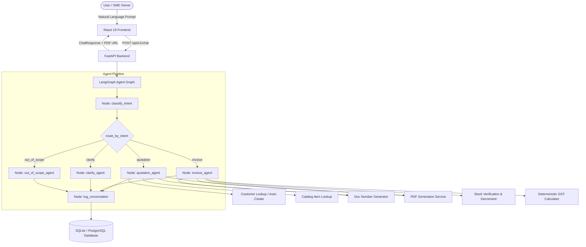

# M1M (Munim.ai) — Technical Architecture & System Context

This document details the complete technical workings of **M1M (Munim.ai)**, an AI-powered business workflow copilot built for Indian SMEs.

---

## 1. System Overview & Workflow Architecture

M1M processes natural-language business requests (via Web or WhatsApp) into legally compliant commercial documents (Quotations and GST Tax Invoices), updates stock levels, and renders downloadable PDF documents.



---

## 2. How the Chatbot is Working

### 2.1 LangGraph Orchestration & State
- **State Definition (`AgentState`)**: Holds `tenant_id`, `channel`, `raw_message`, `conversation_history`, `full_conversation_text`, `detected_intent`, `extracted_entities`, `missing_fields`, `confidence`, `response_text`, `document_type`, `document_id`, `document_number`, and `data`.
- **Execution Flow**:
  1. `classify_intent`: Evaluates message + historical context. Extracts `customer_name`, `line_items` (with quantities), `quotation_number`, and `is_quotation_conversion`.
  2. `route_by_intent`: Conditional router dispatching to appropriate sub-agent node.
  3. Action Nodes:
     - `quotation_agent`: Resolves customer (or auto-creates), resolves items, computes line totals and subtotal, generates sequential quotation number `Q-YYYYMM-XXX`, writes records, and generates PDF.
     - `invoice_agent`:
       - **Direct Invoice**: Verifies stock availability, computes line-level & aggregate GST (Intra-state CGST+SGST or Inter-state IGST), atomically decrements stock, generates `INV-YYYYMM-XXX`, creates DB records, and generates PDF.
       - **Quotation Conversion**: Validates quotation exists and is not already converted, loads lines and customer, creates invoice, decrements inventory, and updates quotation status to `converted`.
     - `clarify_agent`: Asks targeted clarifying questions if essential details (customer, items, quote number) are missing or confidence is low (< 0.6).
     - `out_of_scope_agent`: Politely deflects requests outside Sprint 1 (e.g. dues reminders, stock queries, payment links, accounting sync).
  4. `log_conversation`: Persists inbound message and outbound bot reply to `conversation_log` table.

### 2.2 Conversation History & Context Awareness
- Chat endpoint receives `conversation_history: List[ConversationMessage]`.
- History is compiled into a chronological dialogue context (`User: ... \n Assistant: ...`) passed to the intent classifier.
- Allows follow-up inputs like answering a customer name or choosing "quotation" after a clarification prompt without losing context.

### 2.3 Deterministic GST Calculation & Stock Safety
- **No LLM Math**: All monetary values, taxes, and stock levels are computed strictly via deterministic Python modules using `decimal.Decimal` and `ROUND_HALF_UP`.
- **GST Rules**:
  - Intra-State (Supplier State == Customer State): Line GST split into CGST (50%) and SGST (50%).
  - Inter-State (Supplier State != Customer State): Full GST applied as IGST.
- **Fail-Safe Stock**: Direct invoices and conversions run a pre-check on `Stock.quantity_available`. If stock is insufficient, the transaction fails before writing the invoice or altering inventory.

---

## 3. How the Database is Structured

### 3.1 Multi-Database Support & Configuration
- Powered by **SQLAlchemy 2.x async** and **Alembic migrations**.
- Configurable via `.env`:
  - `DB_ENVIRONMENT=sqlite` -> file-based `m1m.db` at workspace root (zero-configuration dev).
  - `DB_ENVIRONMENT=local_postgres` -> local PostgreSQL 15+ instance.
  - `DB_ENVIRONMENT=supabase` or `DATABASE_URL=...` -> managed PostgreSQL (Supabase / Neon / Heroku).

### 3.2 Schema & Entities
| Table Name | Primary Purpose | Key Fields | Relationships |
|---|---|---|---|
| `tenants` | Multi-tenant root isolation | `id`, `business_name`, `gstin`, `state`, `owner_phone` | Parent of all operational entities |
| `app_users` | User accounts / SME operators | `id`, `tenant_id`, `name`, `phone`, `role`, `is_active` | Belongs to `Tenant` |
| `customers` | Client records | `id`, `tenant_id`, `name`, `gstin`, `state`, `phone`, `address` | Belongs to `Tenant` |
| `items` | Product/Service catalog | `id`, `tenant_id`, `name`, `hsn_code`, `gst_rate_percent`, `unit_price`, `unit` | Belongs to `Tenant` |
| `stock` | Live inventory balance | `id`, `tenant_id`, `item_id`, `quantity_available` | References `Item` (1:1 per tenant) |
| `quotations` | Price estimates / quotations | `id`, `tenant_id`, `customer_id`, `quotation_number`, `status` (`draft`/`converted`), `subtotal`, `pdf_url` | Belongs to `Customer`, has many `QuotationLines` |
| `quotation_lines` | Quotation item breakdown | `id`, `quotation_id`, `item_id`, `quantity`, `unit_price`, `line_total` | Belongs to `Quotation` & `Item` |
| `invoices` | Tax invoices | `id`, `tenant_id`, `customer_id`, `quotation_id`, `invoice_number`, `subtotal`, `cgst_amount`, `sgst_amount`, `igst_amount`, `total_amount`, `status`, `pdf_url` | Belongs to `Customer`, optionally references `Quotation` |
| `invoice_lines` | Tax invoice line items | `id`, `invoice_id`, `item_id`, `quantity`, `unit_price`, `gst_rate_percent`, `line_total` | Belongs to `Invoice` & `Item` |
| `payments` | Payment tracking | `id`, `tenant_id`, `invoice_id`, `amount`, `payment_mode`, `paid_at` | Belongs to `Invoice` |
| `conversation_logs` | Interaction audit trail | `id`, `tenant_id`, `channel`, `direction`, `raw_message`, `detected_intent`, `agent_invoked` | Belongs to `Tenant` |
| `tally_connections` & `external_id_maps` | Accounting sync placeholders | `id`, `tenant_id`, `tally_guid`, `entity_type`, `internal_id`, `external_id` | Belongs to `Tenant` |

---

## 4. Fallback Mechanisms (Status & Implementation)

All major fallbacks **are actively implemented and tested**:

| Subsystem | Fallback Mechanism | Implementation Details |
|---|---|---|
| **Intent Classification & LLM** | **Regex Pattern Matching Fallback** | In `intent_classifier.py`: If `GEMINI_API_KEY` is missing, rate-limited, offline, or returns malformed JSON, the classifier falls back to `_extract_via_regex()`. It identifies quotation vs invoice, extracts customer names, quantities, item names, and quotation conversion numbers (`Q-YYYYMM-XXX`). |
| **PDF Rendering** | **Pure Python PDF 1.4 Binary Generator** | In `pdf_service.py`: WeasyPrint requires native C-libraries (Pango/cairo/GDK) that may not exist on standard Windows setups. If WeasyPrint throws an exception, it falls back to `_generate_minimal_pdf_bytes()` to synthesize a standard PDF 1.4 binary file. |
| **Tenant Context** | **Default Seed Tenant UUID** | In `config.py`: If `SPRINT_TENANT_ID` is unset, `effective_sprint_tenant_id` falls back to `a0eebc99-9c0b-4ef8-bb6d-6bb9bd380a11` (Vaidya Industrial Supplies). |
| **Customer Lookup** | **Fuzzy Token Matching -> Auto-Creation** | In `customer_lookup.py`: Tries exact match -> normalized match -> token overlap (score >= 0.4). If no customer is found, `create_customer_if_missing` automatically inserts the new customer so the transaction is not blocked. |
| **Customer State (GST)** | **Supplier State Fallback** | In `invoice_service.py`: If a customer has no state registered, it defaults to the tenant's supplier state (`customer.state or tenant.state`), safely generating Intra-State (CGST + SGST) taxes instead of erroring out. |
| **Database Connection** | **Zero-Config SQLite Fallback** | In `config.py`: If no `DATABASE_URL` or postgres settings are configured, it defaults to `sqlite+aiosqlite:///{workspace_root}/m1m.db`. |
| **LangGraph DB Session** | **Dynamic Session Context** | In `graph.py`: If no active session is passed via `RunnableConfig`, `_get_session` creates an `AsyncSessionLocal()` on the fly. |

---

## 5. Limitations of the Chatbot (Sprint 1 MVP Scope)

1. **Catalog Dependency for Items**:
   - The chatbot does **not** auto-create items. Unknown item names result in a rejection asking the user to add the item with HSN code, GST rate, and unit price.
2. **Single Active Development Tenant**:
   - Multi-tenancy is scoped via `SPRINT_TENANT_ID` configuration rather than dynamic multi-user authentication / JWT bearer tokens.
3. **Out-of-Scope Workflows**:
   - Dues reminders, ledger queries, inventory checks ("how many rods left?"), payment link generation, and Tally sync are intentionally deflected to future sprints.
4. **Natural Language Complexity**:
   - Multi-item inputs without Gemini (under regex fallback) only parse the first primary line item (`... for <customer> for <qty> <item>`). Full multi-item compound parsing requires Gemini.
5. **No WhatsApp Cloud Webhook Delivery**:
   - WhatsApp channel is supported structurally in DB & LangGraph state, but external webhook receiving/sending to Meta Graph API is not live in Sprint 1.

---

## 6. How to Run and Verify the Project

### Step 1: Environment & Dependencies
```powershell
# Activate Python virtual environment
.venv\Scripts\Activate.ps1

# Upgrade pip and install backend dependencies
python -m pip install -r backend\requirements.txt

# Install frontend dependencies
cd frontend
npm install
cd ..
```

### Step 2: Database Migrations & Deterministic Seeding
```powershell
# Run Alembic migrations from backend/
cd backend
alembic -c alembic.ini upgrade head
cd ..

# Run idempotent seed script
python backend\scripts\seed.py
```

### Step 3: Start the Backend Server (Terminal 1)
```powershell
.venv\Scripts\Activate.ps1
uvicorn app.main:app --app-dir backend --reload --host 127.0.0.1 --port 8000
```
- Health Check: `http://127.0.0.1:8000/health`
- Swagger UI Docs: `http://127.0.0.1:8000/docs`

### Step 4: Start the Frontend UI (Terminal 2)
```powershell
cd frontend
npm run dev
```
- Open Web UI: `http://localhost:5173`
- The frontend proxies `/api` and `/documents` requests to `http://127.0.0.1:8000`.
